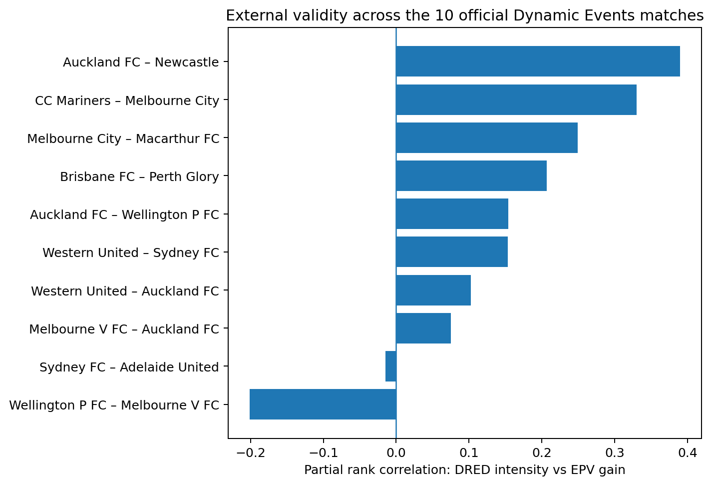

# Defensive Re-Expansion Debt (DRED)

**PySport Analytics Cup 2.0 — Football / Europe**

> Compactness is a snapshot. DRED measures whether a defence can re-open after penetration.

## Problem

After the second-last defensive line is broken, a defence can recover in very different ways. Some teams quickly restore lateral coverage; others collapse toward the ball and remain abnormally narrow, leaving the next action easier to develop.

DRED turns that recovery process into an interpretable tracking metric.

## Metric

Using SkillCorner XY tracking at 10 Hz, I measure outfield defensive width and build a robust reference width separately for each match, defending team and out-of-possession phase.

`z_width(t) = (width(t) - median_width) / robust_scale`

After a second-last-line break, abnormal contraction is:

`contraction(t) = max(-z_width(t) - 1, 0)`

Two related outputs are useful:

- **DRED**: the time-integral of abnormal contraction, representing accumulated recovery debt.
- **DRED intensity**: the mean contraction during the observed recovery window, separating structural severity from how long the possession lasts.

The window is capped at 10 seconds and ends earlier when the attacking phase ends.

## External validation with EPV

The primary validation uses the **10 official Analytics Cup matches with Dynamic Events**. SkillCorner EPV estimates near-term scoring value, and `possession_epv_delta_for` measures how that value changes during an individual player possession.

Among **603 second-last-line-break player possessions** with EPV, raw DRED-intensity versus EPV gain has Spearman rho **0.126**. Duration matters, so the main analysis does not stop there: within each match I rank-adjust for recovery-window duration, player-possession duration, EPV at the start of the action, and static defensive width at the break.

The adjusted pooled partial-rank association is **0.174**. More importantly, the per-match partial association is positive in **8/10** matches, with median **0.154** and a match-bootstrap 95% interval of **0.044 to 0.268**.



The effect is modest, which is expected for a single interpretable structural variable, but it persists after controlling the main duration and context confounds.

## Body Pose mechanism check

The two official Body Pose matches provide an independent mechanism check. Before inspecting the result, the hypothesis was fixed: if a defence is failing to re-expand, defenders should be less oriented outward relative to their team centre.

That direction appears in **both** matches. Mean outward shoulder-orientation readiness is lower in abnormally contracted frames:

- match 1925299: **-0.202** contracted vs **-0.075** normal width;
- match 1996435: **-0.101** contracted vs **-0.020** normal width.


Body Pose is exploratory support only: there are two matches and adjacent frames are serially dependent.

## A failed shortcut we kept

An earlier version used `lead_to_shot` as the main outcome. DRED reached AUC **0.624**, but remaining possession-window duration alone reached **0.650**. When events were compared inside the same match and nearly identical recovery durations, DRED fell to conditional AUC **0.540**.

So shot-link prediction was **demoted rather than defended**. It remains in `make shot-audit` as a reproducible confounding check, not as the project claim.

## Reproduce

Competition data is not committed to this repository.

```bash
make install
make all
```

`make all` downloads/verifies the official tracking data, computes DRED, runs EPV validation, builds the matched case study and runs tests.

Body Pose is optional because the two archives total about 1.2 GB:

```bash
make bodypose
```

The public-data 20-match exploration used during hypothesis development is available only through explicitly named `*-public-all` targets and is not primary submission evidence.

## Interpretation

DRED is a **diagnostic coaching metric**, not a causal model and not a pre-break prediction system. It identifies possessions where lateral defensive recovery remains impaired after penetration, making those sequences easier to retrieve, compare and coach.
