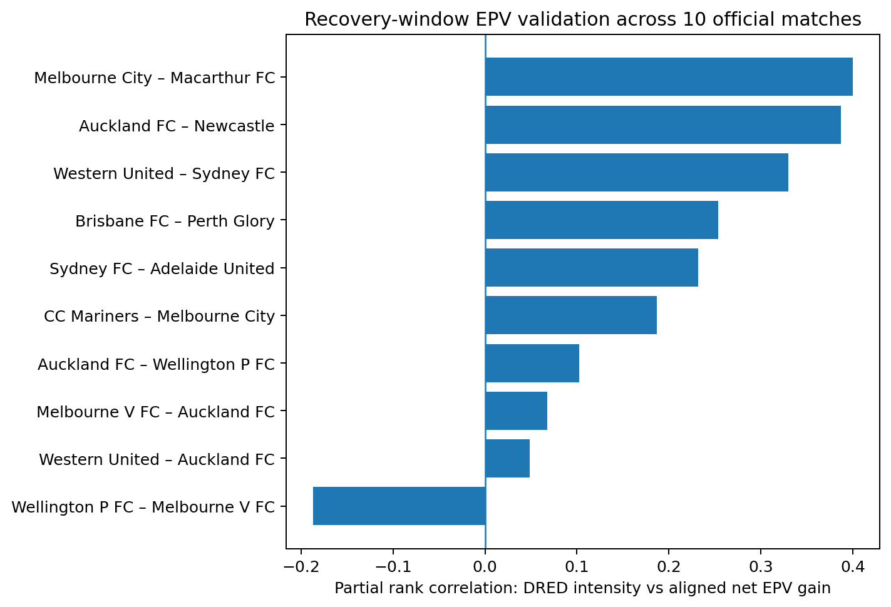
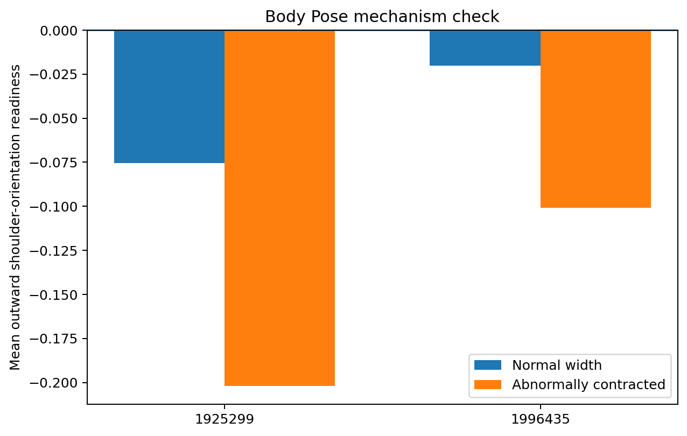

# Defensive Re-Expansion Debt (DRED)

**PySport Analytics Cup 2.0 — Football / Europe**

> Compactness is a snapshot. DRED measures whether a defence can re-open after penetration.

## Problem

After the second-last defensive line is broken, a defence can recover in very different ways. Some teams quickly restore lateral coverage; others collapse toward the ball and remain abnormally narrow, leaving the next action easier to develop.

DRED turns that recovery process into an interpretable tracking metric.

## Metric

Using SkillCorner XY tracking at 10 Hz, I measure outfield defensive width and build a robust reference width separately for each match, defending team and out-of-possession phase.

`z_width(t) = (width(t) - median_width) / robust_scale`

After a second-last-line break, abnormal contraction is:

`contraction(t) = max(-z_width(t) - 1, 0)`

Two related outputs are useful:

- **DRED**: the time-integral of abnormal contraction, representing accumulated recovery debt.
- **DRED intensity**: the mean contraction during the observed recovery window, separating structural severity from how long the possession lasts.

The window is capped at 10 seconds and ends earlier when the attacking phase ends.

The metric is also available as a small reusable Python API:

```python
from defensive_recovery import compute_dred
metrics = compute_dred(z_width, fps=10)
print(metrics.intensity, metrics.integral)
```

The API takes contextual width z-scores, so the same DRED definition can be reused with other tracking providers or baseline strategies.

## External validation with recovery-window EPV

The validation uses the **10 official Analytics Cup matches with Dynamic Events**. The initial submission compared 10-second DRED intensity with SkillCorner EPV change during the triggering player possession. That association is reproducible (adjusted partial-rank **0.174**, positive in **8/10** matches), but a post-submission temporal audit showed that DRED restricted strictly to the triggering action is much weaker. That is consistent with DRED being a recovery-process metric, and it motivated a cleaner time-aligned outcome.

For each second-last-line break, I now measure **net EPV gain over the same recovery window as DRED**: starting EPV comes from the triggering possession, and final EPV is the last completed player-possession end value from the same attacking team and phase before the DRED window closes. No possession end beyond the recovery-window boundary is used.

Among **602** eligible events, raw DRED intensity versus aligned net EPV gain has Spearman rho **0.226**. Within each match I rank-adjust for recovery-window duration, triggering-action duration, starting EPV and static defensive width at the break. The adjusted pooled partial-rank association is **0.224**. The per-match association is positive in **9/10** matches, with median **0.209** and match-bootstrap 95% interval **0.068 to 0.330**.



Adversarial checks support direction and event locality: width expansion is negative (**-0.125**), absolute width abnormality is approximately null (**0.011**), pre-break contraction is much weaker (**0.057**) and the previous second-last break by the same defending team is approximately null (**-0.002**). A richer context adjustment remains positive (**0.157**). The effect is not unique to second-last breaks: last-line breaks are also positive, so DRED should be interpreted as a recovery diagnostic after deep penetration rather than a line-specific law.

This aligned-window analysis was developed **after the initial submission**. It is robustness evidence, not a pre-specified causal test.

## Body Pose mechanism check

The two official Body Pose matches provide an independent mechanism check. Before inspecting the result, the hypothesis was fixed: if a defence is failing to re-expand, defenders should be less oriented outward relative to their team centre.

That direction appears in **both** matches. Mean outward shoulder-orientation readiness is lower in abnormally contracted frames:

- match 1925299: **-0.202** contracted vs **-0.075** normal width;
- match 1996435: **-0.101** contracted vs **-0.020** normal width.



Body Pose is exploratory support only: there are two matches and adjacent frames are serially dependent.

## A failed shortcut we kept

An earlier version used `lead_to_shot` as the main outcome. DRED reached AUC **0.624**, but remaining possession-window duration alone reached **0.650**. When events were compared inside the same match and nearly identical recovery durations, DRED fell to conditional AUC **0.540**.

So shot-link prediction was **demoted rather than defended**. It remains in `make shot-audit` as a reproducible confounding check, not as the project claim.

## Reproduce

Competition data is not committed to this repository. From a clean clone:

```bash
python3 -m venv .venv
source .venv/bin/activate
python -m pip install --upgrade pip
make install
make all
```

`make all` downloads/verifies the official tracking data, computes DRED, reproduces the frozen submission analyses, builds the matched case study and runs tests. `make release-audit` checks the submission constraints, licence and accidental inclusion of competition data/media. GitHub CI tests Python 3.11–3.14 and builds a wheel from scratch; a separate manual workflow reproduces the full 10-match analysis.

Post-submission robustness and adversarial temporal checks are reproduced with:

```bash
make hardening
```

Body Pose is optional because the two archives total about 1.2 GB:

```bash
make bodypose
```

Every runnable competition-data target is pinned to the 10 official match IDs encoded in `defensive_recovery.competition`; arbitrary or wider match fetching is intentionally rejected.

## Interpretation

DRED is a **diagnostic coaching metric**, not a causal model and not a pre-break prediction system. It identifies possessions where lateral defensive recovery remains impaired after penetration, making those sequences easier to retrieve, compare and coach.
